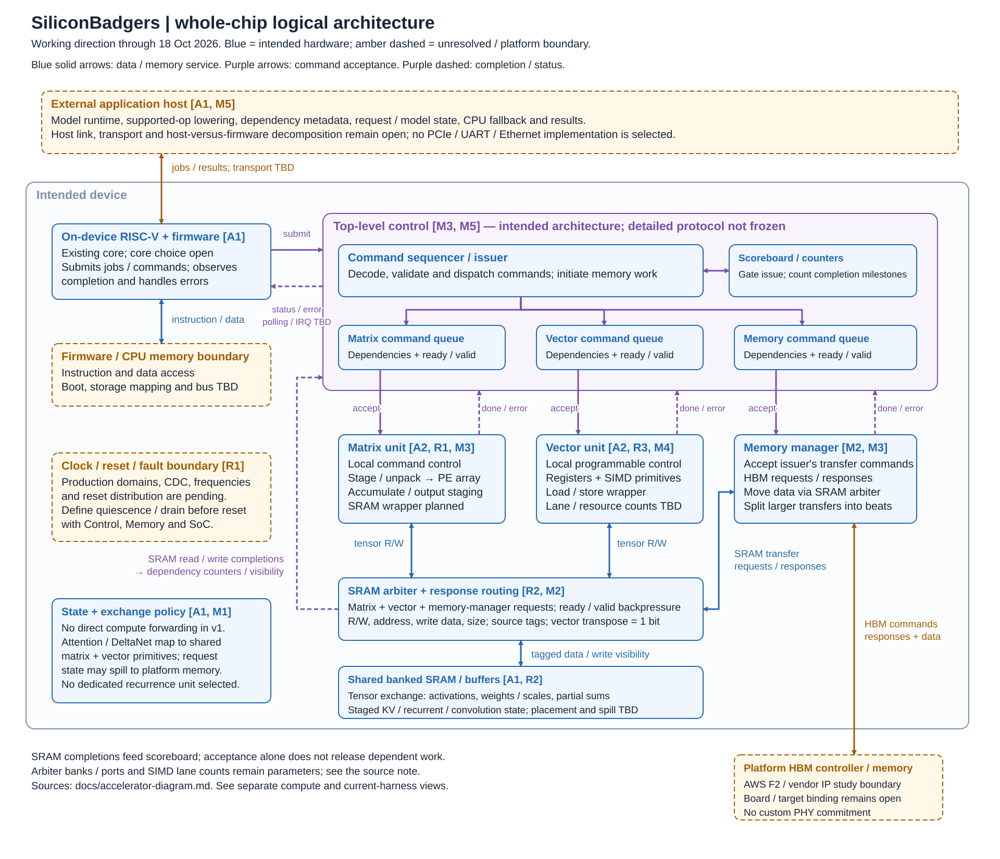
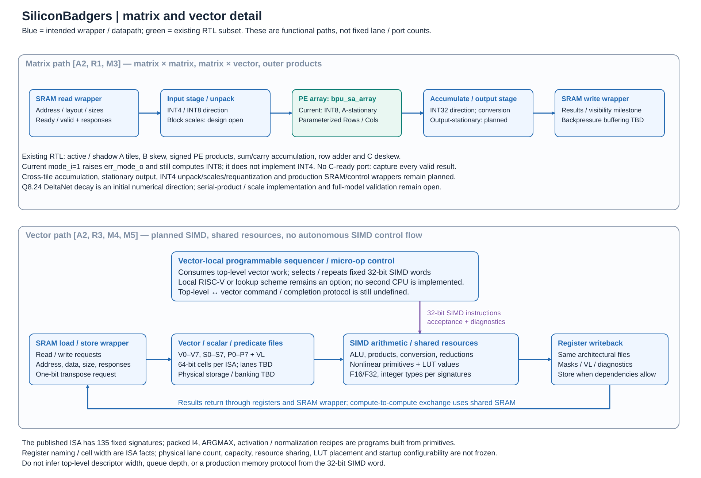
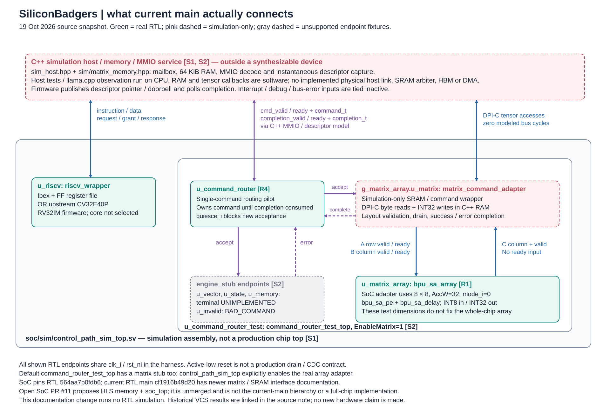

# SiliconBadgers whole-chip architecture

Source snapshot: **October 19, 2026**, incorporating reviewed meeting requirements
through **October 18**. This is the shared whole-device view: host boundary,
on-device RISC-V, control, matrix/vector compute, SRAM and platform memory.
It records intended architecture alongside the smaller implemented RTL subset;
it does not declare a production top, frozen ABI or physical implementation.
Related work: [#8][issue8], [#3][issue3], [#7][issue7] and [#9][issue9].

## Whole-chip view



[Full-resolution SVG](diagrams/whole-chip.svg) · [PNG](diagrams/whole-chip.png)
· [Editable source](diagrams/render_chip.py)

Blue boxes show the intended organization, including hardware still to be
implemented. Amber dashed boxes identify unresolved or platform boundaries.
Solid blue arrows carry tensor data and memory service; purple arrows carry
commands with acceptance/backpressure, and dashed purple arrows carry
completion/status. A bidirectional memory-service arrow summarizes requests
and responses, not a bidirectional electrical signal. Queue boxes name work
classes; they do not prescribe fixed instance counts, depths or interconnects.

The device-side RISC-V submits work to the command sequencer/issuer. Matrix,
vector and memory queues retain dependency information. Software's command
preparation supplies per-unit dependency counter targets; scoreboard counters
advance at defined execution/read/write milestones and gate dependent dispatch
[M3, M5]. Acceptance (`valid && ready`) and completion are distinct. Completion
must reflect the required output visibility, not merely issue.

The **issuer initiates HBM work by commanding the memory manager**. The manager
issues platform HBM-controller requests and moves data to/from SRAM **through
the SRAM arbiter** [M2, M3]. Matrix and vector units exchange tensors through
shared SRAM, with no direct compute forwarding in v1 [A1, M1]. HBM
controller/PHY/IP belongs to the platform boundary; the F2 study is not a custom
HBM PHY commitment. There is no vector-to-HBM shortcut or SRAM bypass.

KV cache, recurrent state and convolution history remain request/sequence
state. Shared matrix/vector primitives serve attention and DeltaNet; the old
four functional boxes are not four selected independent engines. State
placement, spilling, lifetime and fault recovery remain cross-team work.

## Matrix and vector detail



[Full-resolution SVG](diagrams/compute-detail.svg) · [PNG](diagrams/compute-detail.png)

The intended matrix path is SRAM read → stage/unpack → PE array →
accumulation/output staging → SRAM write. INT4/INT8 weights, INT8 activation,
INT32 ordinary accumulation and stationary output are initial directions [A2].
**Current `bpu_sa_array` is A-stationary INT8**, with parameterized `Rows`,
`Cols`, `AccW`, shadow A tiles, B skew and C deskew. INT4 mode reports an error
while continuing INT8 computation; it is not INT4 support. C has no ready
signal: wrappers must reserve capacity and capture every valid result.
INT4 unpack/scales, cross-tile accumulation, requantization, output-stationary
redesign and production SRAM/control wrappers remain planned [R1].

The vector path is SRAM load/store wrapper → register files → shared SIMD
arithmetic/reduction/nonlinear resources → register writeback → SRAM.
A **logical vector-local programmable sequencer** selects and repeats
micro-operations. The recorded compute team decision selects a local RISC-V
core to issue SIMD primitives [A2]. Lookup/program-storage-based sequencing is
an alternative proposal that would require an explicit change to that decision.
The diagram does not claim an implemented second CPU. Top-level ↔ vector protocol
remains undefined in the October 18 notes [M5]. Startup configurability is only
an option.

The published ISA defines fixed 32-bit little-endian instructions, 135 signatures,
V0–V7, S0–S7, P0–P7, 64-bit cells and active `VL` [R3]. F16/F32 and integer
types follow each signature; I16 is supported in specified conversions, not
every ALU operation. Packed I4, ARGMAX and activation/normalization recipes are
programs composed from primitives. Physical lane count, register banking,
shared-resource allocation and LUT placement remain open. Initial Q8.24
DeltaNet decay is not a validated model-wide numerical contract; serial
products, block scaling and sizing remain active design work [A2, M3].

## Current RTL and simulation hierarchy



[Full-resolution SVG](diagrams/implemented-hierarchy.svg) · [PNG](diagrams/implemented-hierarchy.png)

SoC main `8e7bf113adc73833e1a34100382a0daf59011238` assembles
`control_path_sim_top` → `riscv_wrapper` and `command_router_test_top`.
The latter instantiates real `command_router` RTL, a **simulation-only**
`matrix_command_adapter` around the real INT8 array, vector/state/memory stubs
returning `UNIMPLEMENTED`, and an invalid route returning `BAD_COMMAND`.
The default router-test configuration also stubs matrix; the CPU harness
explicitly enables it [S1, S2, R4].

CPU instruction/data service and descriptor/MMIO traffic pass through C++
models. The matrix adapter uses DPI-C tensor callbacks. This main-branch
assembly has no production host link, RTL register bank, DMA, shared SRAM
arbiter, HBM path or interrupt service. No complete synthesizable chip top was
found on current default branches. [SoC PR #11][soc11] proposes HLS memory and
`soc_top`; it remains **open**, so it is not drawn as merged implementation.

SoC pins RTL `564aa7b0fdb653277c726ca05f1edffa7339dd70`; independently inspected
RTL main is `cf1916b49d202a3ba0bff576989ed17d2b66b646`. Newer matrix/SRAM
documentation explains interfaces without silently advancing SoC's component
pin. Historical simulation results remain in the [integration guide][socguide];
they were not rerun for this documentation change.

## Unresolved contracts and source differences

| Topic | What remains open or differs between sources |
|---|---|
| Host/device | Physical link, host/firmware decomposition, command granularity, addresses/visibility, boot memory, polling/IRQ and core selection [A1, M5]. No custom CPU or RISC-V ISA is introduced. |
| Control | Queue depth/concurrency, top-level descriptor width and vector command/status protocol. The historical one-in-flight / 128-byte descriptor is a comparison baseline; the 32-bit SIMD word is a separate contract [R3, R4, M5]. |
| Scoreboard | Counter widths/wrap, command dependency targets versus SRAM source-tag milestones, execution milestones, error handling and global completion/drain rules. |
| SRAM sizing | [R2] is a **merged design specification**, not implemented `sram_arbiter.sv`. Its 8 MiB / 32 banks, four vector ports, 4096-bit rows and priority policy are local proposal values, not frozen whole-chip resources. |
| Size / transpose | [R2] has a 10-bit **matrix** size field for 1–512 bytes, fixed 512-byte MM beats and fixed 128-byte vector slices. Vector transpose is **one bit**, not an external lane mask. October 17 discussion requires larger transfers to split into ≤512-byte requests. End-to-end command/ISA/manager consistency is not established; do not infer a universal variable-size MM port. |
| Completion / ordering | [R2] uses source tags plus per-source acceptance order, read-response pulses with **no response backpressure**, and read/write completion pulses to the scoreboard. Writes become visible at write completion. Acceptance alone does not resolve RAW/WAR/WAW. Consumers must bound outstanding reads to response capacity. |
| Compute / numerics | Matrix dimensions, vector lanes, physical register capacity, buffers, scales, conversion and state precision remain parameters/open decisions. Current INT8 array behavior is narrower than the numerical direction [R1, A2, issue #9]. |
| Platform / clocks | FPGA-first direction; F2/HBM is a study boundary, not a selected board or production binding. Clock/reset domains, CDC, frequencies, macros, physical I/O and packaging are not frozen. The harness's shared `clk_i` / `rst_ni` does not settle production reset/drain semantics with outstanding traffic [A1, M6]. |
| Other proposals | [Architecture PR #14][arch14] is an open-decision inventory, not an approval. [Software PR #22][sw22] estimates logical bytes; its 8/32/64 B-per-cycle SRAM scenarios are proposals, not measured bandwidth or selected port widths. |

## Source-of-truth index

Default branches and recent merged RTL #14/#17/#18/#21/#22, architecture #13,
and SoC #10 were inspected, along with open architecture #14, SoC #11 and
Software #22. Architecture baseline: `528a935f4fe0bd3a34b978cc2c51131c0b9991d5`.
Meeting decisions were reconciled from the requirements review of club notes;
no inaccessible recording or denied slide was used as evidence.

| ID | Source and claim |
|---|---|
| A1 | [System boundaries at architecture baseline][a1]: on-device RISC-V, shared SRAM, state, host split and open platform contracts. |
| A2 | [Merged compute decisions][a2]: matrix/vector organization, stationary-output direction, local RISC-V issue of SIMD primitives, vector kernels and initial numerical direction. |
| R1 | [Matrix Unit I/O][r1], [array RTL][array]: implemented INT8 datapath versus planned wrappers/extensions. |
| R2 | [Merged SRAM arbiter I/O scheme][r2]: requests, transpose, size, tags, response order and scoreboard visibility. |
| R3 | [32-bit SIMD ISA][r3], [signature catalogue][signatures]: exact instruction, register and numerical semantics. |
| R4 | [Command router pilot][r4]: provisional single-command routing, acceptance, completion, quiesce and reset. |
| S1 | [SoC assembly][s1], [RISC-V wrapper][rv]: existing-core hierarchy and clock/reset. |
| S2 | [Router test assembly][s2], [matrix adapter][adapter], [integration guide][socguide]: real array versus simulation wrappers/stubs. |
| M1 | [October 3 Compute][m1]: SRAM exchange, no direct forwarding in v1, provisional unit counts. |
| M2 | [October 6 Controller][m2]: HBM ↔ memory manager ↔ SRAM arbiter replaces bypass sketches. |
| M3 | [October 17 Compute][m3]: issuer, queues/counters, issuer-initiated HBM, SRAM-sized transfer splitting and active block scaling. |
| M4 | [October 10 Compute][m4]: top-level versus vector-local sequencing, 32-bit vector word, one-bit transpose. |
| M5 | [October 18 Software][m5]: command format usable for software work; vector/top-level protocol undefined, startup configurability optional, FPGA-first discussion. |
| M6 | [October 13 Physical Design][m6], [September 28 technical sync][sync]: nonsynthesizable simulation versus hardware, platform/clock constraints. |

## Changes and reproduction

The [September 22 Mermaid baseline](accelerator-diagram-2026-09-22.md) is
preserved unchanged. This revision replaces four candidate engines with
matrix/vector functions and memory management, adds unit queues/scoreboard,
makes HBM-to-SRAM arbitration explicit, separates vector-local control from
top-level RISC-V, and documents the actual RTL/simulation hierarchy. It approves
no new interface, count, memory size or ABI. [Slide register/descriptor
tables](register-maps.md) remain historical comparison baselines.

All views come from [render_chip.py](diagrams/render_chip.py), an editable
fixed-layout SVG generator. SVGs are editable vector documents; PNGs are
rendered previews. Separate sheets and orthogonal routes keep wires and labels
readable. No image-generation model is used. Prerequisites: uv 0.12.23+,
Python 3.11+ and Arial/Helvetica or a compatible sans-serif font.

```sh
uv run --no-project --python 3.12 --with resvg-py==0.5.0 python docs/diagrams/render_chip.py
git diff --check
```

SVG-only editing needs no third-party package:

```sh
uv run --locked python docs/diagrams/render_chip.py --svg-only
```

Verified with uv 0.13.1, CPython 3.12.15 and resvg-py 0.5.0: all three SVGs
parse and render to PNG (1920×1650, 1920×1310, 1920×1320). All images were
visually inspected at readable resolution after layout corrections. Local
documentation/source links and whitespace were checked. PNG pixels can vary
with installed fonts. Documentation only: no RTL simulation, synthesis, FPGA
performance, model-quality, timing, power, CDC or coverage check was run or implied.

[issue3]: https://github.com/SiliconBadgers/architecture/issues/3
[issue7]: https://github.com/SiliconBadgers/architecture/issues/7
[issue8]: https://github.com/SiliconBadgers/architecture/issues/8
[issue9]: https://github.com/SiliconBadgers/architecture/issues/9
[a1]: https://github.com/SiliconBadgers/architecture/blob/528a935f4fe0bd3a34b978cc2c51131c0b9991d5/contracts/system-boundaries-and-evidence.md
[a2]: https://github.com/SiliconBadgers/architecture/blob/528a935f4fe0bd3a34b978cc2c51131c0b9991d5/decisions/compute-team-decisions.md
[r1]: https://github.com/SiliconBadgers/rtl/blob/cf1916b49d202a3ba0bff576989ed17d2b66b646/docs/compute/matrix_unit_io_scheme.md
[array]: https://github.com/SiliconBadgers/rtl/blob/cf1916b49d202a3ba0bff576989ed17d2b66b646/rtl/compute/Matrix_Unit/bpu_sa_array.sv
[r2]: https://github.com/SiliconBadgers/rtl/blob/cf1916b49d202a3ba0bff576989ed17d2b66b646/docs/memory/sram_arbiter_io_scheme.md
[r3]: https://github.com/SiliconBadgers/rtl/blob/cf1916b49d202a3ba0bff576989ed17d2b66b646/docs/simd-isa.md
[signatures]: https://github.com/SiliconBadgers/rtl/blob/cf1916b49d202a3ba0bff576989ed17d2b66b646/docs/simd-isa-signatures.md
[r4]: https://github.com/SiliconBadgers/rtl/blob/cf1916b49d202a3ba0bff576989ed17d2b66b646/docs/control/command-router.md
[s1]: https://github.com/SiliconBadgers/soc/blob/8e7bf113adc73833e1a34100382a0daf59011238/sim/control_path_sim_top.sv
[rv]: https://github.com/SiliconBadgers/soc/blob/8e7bf113adc73833e1a34100382a0daf59011238/rtl/riscv_wrapper.sv
[s2]: https://github.com/SiliconBadgers/soc/blob/8e7bf113adc73833e1a34100382a0daf59011238/sim/command_router_test_top.sv
[adapter]: https://github.com/SiliconBadgers/soc/blob/8e7bf113adc73833e1a34100382a0daf59011238/sim/matrix_command_adapter.sv
[socguide]: https://github.com/SiliconBadgers/soc/blob/8e7bf113adc73833e1a34100382a0daf59011238/docs/integration/README.md
[arch14]: https://github.com/SiliconBadgers/architecture/pull/14
[soc11]: https://github.com/SiliconBadgers/soc/pull/11
[sw22]: https://github.com/SiliconBadgers/software/pull/22
[m1]: https://app.notion.com/p/3ee38826be1b81668497e19a4ea5994f
[m2]: https://app.notion.com/p/3f238826be1b81ff9d04d4f927a5a3fd
[m3]: https://app.notion.com/p/3fd38826be1b81a2a0cbd0eb0fce8414
[m4]: https://app.notion.com/p/3f538826be1b81e1a8e0d468ad655828
[m5]: https://app.notion.com/p/3fe38826be1b81fba504c5b19ea206cb
[m6]: https://app.notion.com/p/3f938826be1b8123af96ec63a394f18a
[sync]: https://app.notion.com/p/3e938826be1b810889c4f4a0b672ccad
